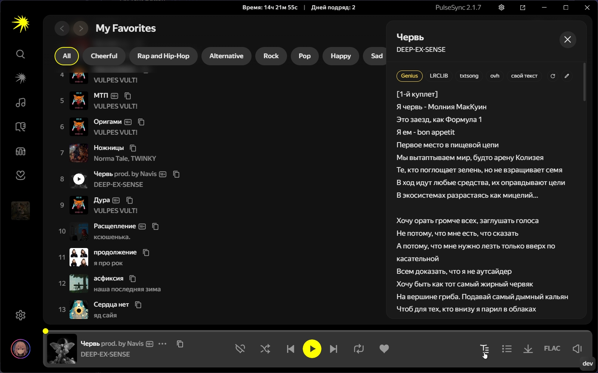

# FallbackLyrics

Неофициальный аддон для PulseSync и расширение для Chrome: подтягивает альтернативный текст песни для Яндекс Музыки, если у трека нет родного (или заместо орига)

## Что умеет

- Автоматически ищет текст, когда обычный недоступен.
- Переключает источники в доке и запоминает выбранный вариант для каждого трека отдельно.
- Сохраняет текста в кэше; кнопка обновления делает новый запрос.
- Позволяет править текст источника (кнопка релоада делает новый запрос и возвращает ориг или че он отдаст там)
- Отдельная вкладка «свой текст»: можно вставить свой текст.
- Не кэширует пустой результат: если ничего не нашлось, при следующем открытии поиск повторится.

## Установка

1. Скачайте архив со страницы [Releases](https://github.com/eretly/FallbackLyrics/releases).
2. Распакуйте его в `%APPDATA%\PulseSync\addons\`. В архиве уже лежит папка `e4f8b912-881c-4b53-9021-998cb4b0a112` - просто закиньте её туда, и всё.
3. Перезапустите PulseSync.
4. Включите FallbackLyrics в списке аддонов.

Если скачали «Source code (zip)», папка внутри называется `FallbackLyrics-1.0.0` - переименуйте её в `e4f8b912-881c-4b53-9021-998cb4b0a112`, иначе аддон не подхватится.

## Расширение для Chrome (веб-версия)

В репозитории есть версия в виде расширения Manifest V3 для браузерной Яндекс Музыки.

1. Скачайте `FallbackLyrics-extension.zip` из [Releases](https://github.com/eretly/FallbackLyrics/releases) или возьмите папку [`extension`](./extension) из репозитория.
2. Откройте `chrome://extensions`, включите «Режим разработчика».
3. Нажмите «Загрузить распакованное» и выберите папку `extension` (внутри неё лежит `manifest.json`).
4. Откройте https://music.yandex.ru и включите трек.

Работает так же: если родного текста нет - кнопка текста остаётся активной и открывает альтернативный; если есть - зажмите её на ~800 мс. Если нативной кнопки на вебе нет вообще, справа снизу появляется кнопка «Текст». Запросы к внешним источникам идут через service worker, чтобы обойти CORS.

## Совместимость

PulseSync и Яндекс Музыка (десктоп), Chrome и music.yandex.ru (расширение). Версия аддона и расширения: `1.0.0`.

## Примечание

Аддон неофициальный и не связан с PulseSync или Яндекс Музыкой. Тексты загружаются с публичных источников; права на тексты принадлежат их правообладателям.

## Статус и планы

- Аддон может обновляться: баг-фиксы и новые источники текста будут появляться в этом репозитории.
- В официальном сторе аддонов PulseSync его не будет - никогда. Только ручная установка отсюда.
- Код полностью написан через ИИ. Да, целиком. Работает - и ладно.

## Мысли вслух

- Встроенный поиск текстов в клиенте - лотерея. Находит не то, не всегда и не там.
- Точный поиск логичнее иметь в самом клиенте, а не городить сбоку.
- Тексты есть не везде, идеального покрытия не будет. Но даже "хоть что-то вместо пустой кнопки" уже лучше, чем ничего.
- Почему в официальном сторе аддонов этого мода не будет: будет много разныех источников, будут использоваться обходы для парса текста и в целом какая то залупа нестабильная, хотя сейчас нормально, но не для продакшена.
